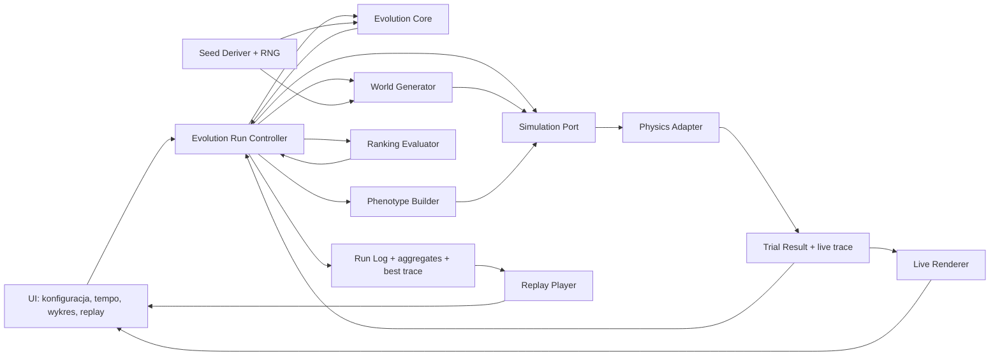

# Evolution Lab — warianty architektury

**Data porównania:** 2026-07-29

**Status:** stos produkcyjny zaakceptowany i zaimplementowany
**Założenie:** pierwsza wersja jest lokalną, ciągłą symulacją owner-first

> Decyzja właściciela z 2026-07-29: Godot jest wykluczony, a dalsza weryfikacja przebiega wyłącznie w kierunku browser-first. Poniższe porównanie rodzin pozostaje jako ślad rozważonych alternatyw, nie jako lista aktywnych kandydatów.

## 1. Wymagania napędzające architekturę

Architektura ma wspierać:

- jawną separację ewolucji, świata, fenotypu, fizyki, rankingu, zapisu i prezentacji;
- stały krok symulacji niezależny od FPS;
- wersjonowane seedy świata i ewolucji oraz re-symulację w uzgodnionym zakresie;
- replay bez ponownego uruchamiania fizyki;
- automatyczne generowanie terenu, ocenę populacji i przechodzenie przez dowolną liczbę pokoleń;
- elity, automatyczny dobór rodziców, krzyżowanie i mutację;
- normalny, przyspieszony i nierenderowany tryb prób bez zmiany wyniku;
- długi przebieg bez nieograniczonego wzrostu pamięci;
- szybkie strojenie kamery, tempa prób i odczuć gry;
- kontrole gry oraz opcjonalne szczegóły i wyjaśnienia;
- testowanie rdzenia bez UI;
- lokalne działanie bez kont i backendu;
- mały pionowy wycinek bez budowy uniwersalnej platformy;
- możliwość zmiany adaptera fizyki bez przepisania domeny.

## 2. Porównanie rodzin stacku

Poniższa macierz jest **oceną ekspercką desk research**, opartą na wymaganiach projektu i źródłach pierwotnych. Nie jest wynikiem pomiaru T0.

| Kryterium | Modularny browser-first | Godot engine-first | Python + Pymunk |
|---|---|---|---|
| Dystrybucja owner-first | Wysoka: statyczna aplikacja/URL, brak instalatora | Średnia: eksport desktop/web, większy runtime | Niska–średnia: środowisko Python lub pakowanie desktop |
| Szybkość iteracji grywalności | Średnia: fizykę, renderer i UI trzeba złożyć | Wysoka: scena, kamera, animacja i fizyka w jednym środowisku | Niska–średnia dla spójnej gry |
| Kontrole, historia i szczegóły | Wysoka: naturalny DOM/SVG/Canvas | Średnia–wysoka: dobre UI gry, więcej pracy przy dostępności | Wysoka w notebooku, średnia w spójnym UI |
| Narzędzia 2D | Średnia: renderer i fizyka składane osobno | Wysoka: wbudowane scena, renderer i fizyka | Średnia: Pymunk + osobny renderer/UI |
| Kontrola determinizmu | Wysoka warunkowo: zależy od adaptera i całego pipeline'u | Niska dla wbudowanej fizyki | Średnia lokalnie; brak mocnej gwarancji cross-platform |
| Testy headless | Wysoka: domena poza UI, runtime JS/headless browser | Średnia: headless jest dostępny, lecz testy domeny wymagają dyscypliny | Wysoka: naturalny headless i testy Python |
| Długie przebiegi i praca w tle | Wysoka warunkowo: worker i retencja danych wymagają projektu | Średnia–wysoka: pętla silnika pomaga, web export może ograniczać | Wysoka obliczeniowo, słabsza integracja UI |
| Dostępność interfejsu | Wysoka przy użyciu semantycznego DOM | Średnia; więcej pracy w niestandardowym UI | Zależna od wybranego UI |
| Koszt operacyjny v1 | Niski: statyczny hosting lub lokalnie | Niski–średni: artefakty eksportu | Średni dla wygodnej dystrybucji |
| Lock-in | Niski–średni przy portach | Średni–wysoki: sceny, UI i fizyka silnika | Średni: runtime i natywne bindingi |
| Widowiskowość | Średnia–wysoka | Wysoka | Średnia |
| Odwracalność | Wysoka przy kanonicznych DTO | Średnia | Średnia |

### Wariant A — modularny browser-first

**Skład koncepcyjny:** TypeScript, semantyczny DOM dla kontroli i opisów, Canvas dla symulacji, dostępne wykresy DOM/SVG, biblioteka 2D za portem.

**Mocne strony:**

- naturalnie łączy Canvas, kontrolki, wykres trendu i opcjonalne szczegóły;
- lokalny model bez backendu;
- łatwe oddzielenie danych domenowych od renderowania;
- naturalny import/eksport manifestów;
- prosta droga do owner-first oraz późniejszego udostępnienia.

**Ryzyka:**

- trzeba osobno złożyć fizykę, renderer i UI;
- WASM może zwiększyć koszt startu i bundlingu;
- długa seria prób może blokować główny wątek;
- pełna deterministyczność zależy od całego pipeline'u, nie tylko fizyki.

### Wariant B — Godot engine-first — rozważony i wykluczony

Godot ma dedykowany renderer i wbudowany silnik fizyki 2D oraz potrafi działać headless. Eksport webowy opiera się na WebAssembly i WebGL 2; dokumentacja wskazuje też ograniczenia eksportu C# do webu. Najważniejszy problem: oficjalna polityka wydawnicza wprost stwierdza, że **wbudowana fizyka Godota** nie jest deterministyczna. Addon Godot Rapier oferuje deterministyczny serwer fizyki, ale jego dokumentacja zastrzega, że SceneTree i skrypty nadal mogą wprowadzić niedeterminizm; dochodzi też kolejna zależność.

**Mocne strony:**

- dojrzałe narzędzia sceny, fizyki, animacji i debugowania;
- szybkie budowanie widowiskowej symulacji;
- eksport desktop i web.

**Ryzyka:**

- mechanizm laboratorium może zostać podporządkowany drzewu scen;
- analityczny interfejs i dostępność wymagają dodatkowej pracy;
- brak gwarancji deterministycznej fizyki osłabia główną obietnicę;
- większy koszt migracji, jeśli typy silnika przenikną domenę.

**Kiedy wybrać:** gdy szybkość iteracji game feel, narzędzia sceny i widowiskowość przeważą nad wygodą dystrybucji oraz mocniejszym kontraktem powtarzalności.

### Wariant C — Python + Pymunk

Pymunk jest biblioteką 2D opartą na Munk2D/Chipmunk. Oficjalna dokumentacja zaleca stały timestep dla stabilności i opisuje uruchamianie symulacji niezależnie od renderera.

**Mocne strony:**

- szybkie eksperymenty algorytmiczne i headless;
- naturalne analizy danych;
- łatwy zapis prototypów badawczych i testów.

**Ryzyka:**

- wygodna dystrybucja interaktywnego owner-first UI jest trudniejsza;
- osobne technologie dla UI, renderera i pakowania;
- brak udokumentowanej gwarancji identycznej fizyki między platformami;
- granica między notebookiem a produktem może się rozmyć.

**Kiedy wybrać:** gdy najważniejsza jest eksploracja algorytmu, a aplikacja może być desktopowym/notebookowym narzędziem dla technicznego użytkownika.

## 3. Wniosek z porównania rodzin

Analiza nie dawała bezwarunkowego zwycięzcy: Godot prowadził w narzędziach sceny i szybkim strojeniu widowiskowości, a browser-first w dystrybucji, dostępności i odwracalności modułów. Właściciel wykluczył Godot, dlatego kierunkiem platformy jest teraz **modularny browser-first**.

**Modularny browser-first** prowadzi, jeżeli najważniejsze są:

- natychmiastowa dystrybucja przez URL;
- dostępność i hybryda Canvas + DOM;
- odwracalne granice modułów;
- mocniejszy, testowalny kontrakt powtarzalności.

**Godot engine-first** byłby mocniejszy, gdyby najważniejsze były:

- szybkie strojenie sceny, kamery i animacji;
- czas do przekonującego game feel;
- spójne narzędzia gry 2D;
- akceptacja słabszej gwarancji determinizmu albo użycia dodatkowego adaptera.

Python/Pymunk pozostaje alternatywą badawczą, lecz nie jest aktywnym kandydatem do spójnej, łatwo uruchamianej gry. Może wrócić wyłącznie jako jawny pivot, jeśli oba adaptery przeglądarkowe nie spełnią bramek T0.

Brak backendu pozostaje rekomendacją dla v0. T0 nie wybiera już platformy; rozstrzyga adapter fizyki i zakres powtarzalności według zamrożonych wag.

## 4. Adapter fizyki w wariancie browser-first

### Rapier2D — dwa różne warianty

Od Rapier.js 0.15 oficjalne pakiety mają różne profile:

- `@dimforge/rapier2d` — wydajny wariant główny, lokalnie deterministyczny na tej samej maszynie, bez gwarancji cross-platform;
- `@dimforge/rapier2d-deterministic` — mniej zoptymalizowany wariant z gwarancją cross-platform dla fizyki, jeśli zachowane są identyczne wejścia i kolejność operacji.

Rapier działa przez WebAssembly i ładuje się asynchronicznie. Nie zawiera produkcyjnego renderera. Dokumentacja pozwala ustawić timestep i iteracje solvera.

**Mocne strony wariantu deterministic:**

- najmocniejsza oficjalna deklaracja powtarzalności między platformami;
- 2D, rigid bodies, joints i silniki pasujące do pojazdu;
- snapshot świata i debug geometry;
- naturalny adapter bez typów domenowych silnika.

**Koszty/ryzyka:**

- niższa optymalizacja niż pakiet główny;
- WASM, asynchroniczny start i potencjalne problemy bundlerów;
- gwarancję może zerwać niedeterministyczne przygotowanie wejść, np. funkcje transcendentalne JS;
- identyczna wersja i kolejność tworzenia/usuwania obiektów są obowiązkowe;
- snapshot nie jest trwałym formatem cross-version.

### Planck.js

Planck.js jest portem koncepcji Box2D w JavaScript. Oficjalna dokumentacja deklaruje powtarzalność dla tych samych wejść w tym samym runtime JavaScript, ale nie między platformami. Biblioteka nie renderuje i wymaga jawnego kroku `world.step`.

**Mocne strony:**

- prostszy runtime bez osobnego WASM;
- bliskość modelu Box2D i pojazdów z przegubami;
- łatwa integracja z dowolnym rendererem/UI;
- dobra odwracalność za portem.

**Koszty/ryzyka:**

- brak cross-platform determinism;
- ograniczenia solvera przy dużych różnicach mas i łańcuchach przegubów;
- brak trwałego renderer/replay;
- powtarzalność trzeba zawęzić do zachowanego runtime/builda.

### Porównanie

| Kryterium | Rapier2D deterministic | Planck.js |
|---|---|---|
| Powtarzalność w tym samym środowisku | Mocna deklaracja, wymaga identycznych wejść | Deklarowana |
| Powtarzalność cross-platform | Deklarowana dla wariantu deterministic i tych samych wejść | Nie |
| Runtime | WASM + JS, async init | JavaScript |
| Wydajność | Potencjalnie wysoka, lecz wariant deterministic mniej zoptymalizowany | Do sprawdzenia na scenariuszu |
| Pojazdy/joints | Tak | Tak |
| Rendering | Brak | Brak |
| Snapshot | Dostępny, wersjo-zależny | Własny zapis domenowy |
| Prostota bundlingu | Niższa | Wyższa |
| Główne ryzyko | Mylenie gwarancji fizyki z gwarancją aplikacji | Zbyt wąski zakres determinizmu |

### Wynik T0

T0 wskazuje **Planck.js 1.5.0** dla M1–M4. W pięciu seriach na trzech seedach
mediana przepustowości headless wyniosła około 96 tys. kroków/s wobec 60 tys.
dla Rapiera. Oba adaptery zachowały powtarzalność w tym samym środowisku,
render invariance i brak nieważnych stanów.

Rapier pozostaje alternatywą, jeśli cross-platform exact stanie się
wymaganiem bezwzględnym. W takim przypadku trzeba osobno przetestować wariant
deterministyczny i cały pipeline wejściowy.

Pełny raport: [t0/T0_BROWSER_RESULT.md](t0/T0_BROWSER_RESULT.md).

## 5. Proponowane granice modułów

### Reguły granic

- `Evolution Core` tworzy populację, elity, rodziców, krzyżowanie i mutacje; nie zna fizyki ani UI.
- `Evolution Run Controller` jako jedyny orkiestruje świat, populacje, próby, ranking, tempo i zapis.
- `World Generator` wyprowadza fragment terenu wyłącznie z seedu świata i indeksu fragmentu.
- `Phenotype Builder` ma kontrakt `(genom, konfiguracja fenotypu) → kanoniczny opis` i nie używa RNG.
- `Simulation Port` przyjmuje kanoniczne dane z jawnymi jednostkami i zwraca domenowy wynik.
- `Ranking Evaluator` jest osobną polityką, nie callbackiem renderera.
- `Seed Deriver` ma stabilne domeny dla świata, inicjalizacji, doboru rodziców, krzyżowania, mutacji i remisów.
- `Run Log` przechowuje agregaty pokoleń oraz ograniczony ślad rekordzisty; live renderer może czytać tylko bieżący trace.
- Żaden typ Rapier/Planck nie wychodzi poza adapter.

## 6. Topologia wykonania

### In-process — rekomendowany początek po akceptacji

Najmniejszy koszt i najłatwiejsze debugowanie. Port symulacji powinien jednak od początku być logicznie asynchroniczny oraz wspierać:

- anulowanie;
- progres partii;
- zwarte wyniki;
- stabilną agregację niezależną od kolejności zakończenia.

### Worker — warunkowy

Worker zostaje dodany tylko, gdy pomiar wykaże przekroczenie budżetu responsywności. Współbieżność nie może zmieniać seedów, kolejności rankingu ani wyników.

### Backend — poza zakresem

Brak wymagania produktowego dla kont, rankingów sieciowych, współdzielenia lub wspólnego środowiska. Backend dodałby operacje i bezpieczeństwo bez wartości dla wersji kierunkowej.

## 7. Kontrakty zapisu i powtarzalności

### Re-symulacja

Ponowne obliczenie z manifestu. Zatwierdzony cel:

- identyczna zachowana wersja aplikacji, adaptera, WASM, RNG i schematów;
- identyczne wejścia i kolejność;
- ten sam runtime JavaScript;
- identyczny teren, ranking, potomstwo i historia pokoleń.

Manifest zawiera build ID i sumę kontrolną. Gwarancja obowiązuje tylko tak długo, jak dostępny jest niezmienny artefakt danego buildu; zaakceptowane release bundle powinny być archiwizowane. Nie obiecujemy identycznej re-symulacji po aktualizacji wersji ani między platformami. Patrz [ADR-0002](adr/0002-bound-repeatability-to-same-build-and-runtime.md).

### Replay

Odtworzenie próbkowanego śladu domenowego bez fizyki. Ma pozostać możliwe po zmianie adaptera, jeśli format śladu jest obsługiwany.

### Resume

Wznowienie z kompletnego `ResumeCheckpoint` tej samej wersji:

- manifest i build ID;
- numer ticku;
- snapshot adaptera;
- stan kontrolera próby, w tym maksymalny postęp, stagnacja i faza;
- bieżące metryki;
- wymagane stany/kursory RNG.

Snapshot silnika jest tylko częścią checkpointu. Resume jest optymalizacją tej samej wersji, nie formatem archiwalnym. Test kontraktowy porównuje `N + M` kroków bez przerwy z `N` krokami, checkpoint/restore i kolejnymi `M` krokami.

### Manifest

Obejmuje co najmniej:

- wersje schematów przebiegu, świata, genomu, fenotypu i rankingu;
- wersję RNG i reguły seedowania;
- wersje inicjalizacji, elit, doboru rodziców, krzyżowania i mutacji;
- wersję adaptera, pakietu i artefaktu WASM/JS;
- parametry fixed timestep i solvera;
- seed świata, liczebność populacji, parametry mutacji, liczbę elit, limit próby i stabilną kolejność;
- wspieraną deklarację powtarzalności.

## 8. Model kosztu

Czas generacji zależy w przybliżeniu od:

> populacja × limit kroków × liczba ciał i złączy × iteracje solvera × ilość telemetrii

Liczebność populacji nie jest jeszcze budżetem. W T0 trzeba zmierzyć co najmniej małą populację referencyjną oraz wariant około 20 pojazdów:

- czas całej generacji;
- najgorszy czas blokady UI;
- pamięć szczytową;
- rozmiar śladu;
- rendering on/off;
- kilka populacji i limitów kroków;
- in-process oraz worker, jeśli budżet zostanie przekroczony.

## 9. Test rozstrzygający — dopiero po zgodzie

Wyrzucalny test referencyjny nie jest częścią obecnego discovery i nie może rozpocząć się bez decyzji właściciela.

### Etap A — wspólny wycinek browser-first

Jeden minimalny shell przeglądarkowy wykonuje ten sam mały scenariusz na obu adapterach:

1. deterministycznie generowany teren z seedu;
2. geometryczny pojazd o stałej topologii i dwóch kołach;
3. mała populacja początkowa;
4. ranking, jedna elita, automatyczny dobór dwóch rodziców, krzyżowanie i mutacja;
5. co najmniej dwa pełne pokolenia bez interakcji;
6. normalne renderowanie i szybki tryb bez renderowania;
7. pause, resume i stop;
8. krótki replay rekordzisty;
9. numer pokolenia, żywe pojazdy oraz najlepszy i średni wynik.

Przed testem właściciel ustala wagi:

- czas do grywalnego rezultatu;
- jakość i szybkość strojenia game feel;
- czas pokolenia w obu trybach;
- responsywność sterowania podczas automatycznych prób;
- stabilność pamięci w wydłużonym przebiegu;
- powtarzalność wystarczająca do debugowania i restartu seedu;
- dystrybucja;
- dostępność;
- testowalność reguł gry bez renderera;
- koszt zależności i migracji.

Godot nie wchodzi do testu. Python/Pymunk może wejść dopiero po niepowodzeniu obu adapterów przeglądarkowych i osobnej decyzji właściciela.

### Etap B — Rapier2D kontra Planck.js i kontrakt powtarzalności

Po wyborze rodziny porównuje się kandydatów zgodnych z decyzją D-07:

1. identyczny genom referencyjny, reguła świata, fixed timestep i liczba kroków w granicach danej rodziny;
2. kilka ustalonych manifestów i seedów;
3. wielokrotne uruchomienie bez renderowania;
4. powtarzalność **wewnątrz każdego kandydata**: teren, ranking, potomstwo i kanoniczny hash posortowanego stanu domenowego;
5. brak oczekiwania identycznego hasha lub trajektorii między różnymi silnikami;
6. render on/off nie zmienia wyniku;
7. pomiar czasu, pamięci, startu i rozmiaru artefaktu;
8. minimalny round-trip manifestu i replay z krótkiego trace.

Jeżeli cross-platform exact pozostaje wymaganiem, warianty bez takiej gwarancji odpadają albo wymaganie musi zostać jawnie poluzowane. Jeżeli wystarcza ten sam runtime/build, prostsze adaptery mogą wygrać kosztem węższej deklaracji.

### Warunkowy test topologii

Test workera i większych populacji uruchamia się wyłącznie, jeśli wariant in-process nie spełnia budżetu responsywności albo przepustowości. Pełna historia przebiegu nie wchodzi do T0; wystarczą agregaty dwóch pokoleń i ślad rekordzisty.

Między adapterami porównuje się stabilność, koszt, ergonomię i jakość zachowania, nie bitowo identyczny stan wewnętrzny.

Kryteria wyboru należy zatwierdzić przed pomiarem, aby wynik nie został dopasowany do preferowanego narzędzia.

## 10. Źródła pierwotne

- [Rapier — warianty oficjalnych pakietów NPM](https://www.npmjs.com/package/@dimforge/rapier2d)
- [Rapier.js changelog — rozdzielenie wariantów od 0.15](https://github.com/dimforge/rapier.js/blob/master/CHANGELOG.md)
- [Rapier — parametry integracji i timestep](https://rapier.rs/docs/user_guides/javascript/integration_parameters/)
- [Rapier — start JS/WASM i ograniczenia bundlingu](https://rapier.rs/docs/user_guides/templates/getting_started_js/)
- [Planck.js — ograniczenia i determinizm](https://piqnt.com/planck.js/docs/limitations)
- [Planck.js — brak renderera i uruchamianie](https://piqnt.com/planck.js/docs/run-your-code.html)
- [Godot — możliwości 2D](https://docs.godotengine.org/en/stable/tutorials/2d/index.html)
- [Godot — fizyka nie jest deterministyczna](https://docs.godotengine.org/en/stable/about/release_policy.html)
- [Godot Rapier — granice determinizmu addonu](https://godot.rapier.rs/docs/documentation/determinism/)
- [Godot — eksport webowy](https://docs.godotengine.org/en/stable/tutorials/export/exporting_for_web.html)
- [Pymunk — fixed timestep, stabilność i wydajność](https://pymunk.readthedocs.io/en/latest/overview.html)

## 11. Decyzje właściciela

1. Platforma — **zdecydowane:** modularny browser-first; Godot wykluczony decyzją właściciela z 2026-07-29.
2. Brak backendu w wersji kierunkowej — rekomendacja: tak.
3. Adapter fizyki — **zdecydowane:** Planck.js 1.5.0; patrz [ADR-0001](adr/0001-use-planck-js-for-vehicle-physics.md).
4. Zakres powtarzalności — **zdecydowane:** identyczny wynik w zachowanym buildzie i tym samym runtime, bez cross-platform exact ani obietnicy cross-version.
5. Cross-platform exact — **poza v0**; jego wprowadzenie wymaga nowej decyzji i T0.
6. Budżety M1–M4 — **zdecydowane:** zatwierdzone bez zmian; [T0_BUDGET_PROPOSAL.md](t0/T0_BUDGET_PROPOSAL.md).
7. Stos produkcyjny — **zdecydowane i zaimplementowane:** TypeScript strict, Vite, natywny DOM + Canvas 2D + SVG i Vitest; [ADR-0004](adr/0004-approve-production-stack-and-m1-m4.md).
8. Topologia wykonania — **zdecydowane:** in-process spełnia budżety; worker pozostaje warunkowy.
9. G0-P — **zakończone pivotem**; T0 — **zakończone**; G1 — **GO**; M1–M4 — **ukończone**.
