# Evolution Lab — roadmapa ciągłej symulacji

**Data aktualizacji:** 2026-07-29
**Status:** G1 oraz M1–M4 ukończone; następna bramka G2-P

## Zasada

Każdy milestone rozszerza jeden działający, automatyczny przebieg. Pierwsza grywalna wersja ma pozwolić ustawić parametry, obserwować dowolną liczbę pokoleń, przyspieszać symulację i wracać do najlepszego pojazdu.

## G0-P — kierunek produktu

**Status:** zakończone.

Pierwsza hipoteza „Hodowcy jednej linii” została odrzucona po storyboardzie. Właściciel zaakceptował pivot:

- automatyczne pokolenia;
- konfiguracja przed startem;
- brak ręcznego wyboru rodziców;
- brak limitu pokoleń;
- obserwacja do decyzji użytkownika;
- doświadczenie zbliżone do BoxCar2D.

**Wynik:** pass do przygotowania T0 dla nowej pętli.

## T0 — porównanie wykonalności

**Status:** zakończone.

### Pytanie

Który adapter fizyki w przeglądarce szybciej i bezpieczniej daje ciągłą, wydajną symulację z przekonującym game feel?

### Ustalona platforma i kandydaci

- platforma: modularny browser-first;
- adapter A: Rapier2D;
- adapter B: Planck.js;
- Godot: wykluczony decyzją właściciela;
- Python/Pymunk: wyłącznie awaryjny pivot wymagający nowej decyzji właściciela, jeśli oba adaptery przeglądarkowe nie spełnią bramek bezwzględnych.

### Wspólny scenariusz

- deterministycznie generowany fragment terenu;
- geometryczny pojazd o stałej topologii i dwóch kołach;
- mała populacja;
- automatyczny ranking;
- elita, dobór dwóch rodziców, krzyżowanie i mutacja;
- co najmniej dwa kolejne pokolenia;
- normalne renderowanie i szybki tryb bez renderowania;
- minimalny ślad replayu najlepszego.

### Mierzone kryteria

- czas do pierwszej wiarygodnej próby;
- czas pokolenia w obu trybach;
- blokowanie UI;
- jakość i stabilność zachowania;
- powtarzalność w obrębie kandydata;
- łatwość strojenia świata i pojazdu;
- koszt dystrybucji;
- dostępność interfejsu;
- testowalność bez renderera;
- koszt zależności i migracji.

**Pass:** jeden kandydat spełnia bramki bezwzględne i wygrywa według wag zatwierdzonych przed testem.

**Wynik:** oba adaptery spełniły bramki. Planck.js jest rekomendowany dzięki
wyższej przepustowości, prostszemu runtime i krótszej drodze do grywalnego
zachowania. Szczegóły: [t0/T0_BROWSER_RESULT.md](t0/T0_BROWSER_RESULT.md).

**Decyzja właściciela:** Planck.js 1.5.0 zatwierdzony.

**Decyzja właściciela:** kontrakt powtarzalności zatwierdzony.

**Decyzja właściciela:** [budżety M1–M4](t0/T0_BUDGET_PROPOSAL.md)
zatwierdzone bez zmian.

## G1 — zgoda na kod produkcyjny

**Status:** GO udzielone.

Po T0 właściciel otrzymuje:

- wynik porównania;
- rekomendowany stack i adapter fizyki;
- kontrakt powtarzalności;
- budżety wydajności;
- pozostałe ryzyka;
- zamrożony plan M1–M4.

Kod produkcyjny rozpoczyna się wyłącznie po jednoznacznym GO.

Porównanie stosu, projekt głębokich modułów i dokładny zakres GO:
[G1_IMPLEMENTATION_BRIEF.md](G1_IMPLEMENTATION_BRIEF.md).

## M1 — świat i pojedynczy pojazd

**Status:** ukończone.

**Rezultat:**

- teren generowany z seedu;
- jeden geometryczny pojazd z dwoma kołami;
- fixed timestep;
- próba kończona przez stagnację lub limit;
- dystans i stabilny wynik;
- normalne tempo, pauza i restart.

**Pytanie:** czy świat i pojazdy generują interesujące, czytelne zachowanie?

**Akceptacja:** ten sam przypadek spełnia kontrakt powtarzalności; renderer nie wpływa na wynik; UI pozostaje sterowalne.

## M2 — automatyczne pokolenia

**Status:** ukończone.

**Rezultat:**

- populacja początkowa;
- ocena wszystkich pojazdów;
- ranking;
- skonfigurowane elity;
- automatyczny dobór rodziców;
- krzyżowanie i mutacja;
- następne pokolenie bez interakcji;
- stabilne pochodzenie i seedy.

**Pytanie:** czy kolejne pokolenia powstają poprawnie i wykazują zróżnicowanie?

**Akceptacja:** co najmniej kilka pokoleń działa bez obsługi; liczebność jest stała; tryb renderowany i nierenderowany daje ten sam wynik.

## M3 — ciągły przebieg i tempo

**Status:** ukończone.

**Rezultat:**

- brak globalnego limitu pokoleń;
- start, pauza, wznowienie i stop;
- normalne, przyspieszone i nierenderowane tempo;
- status pokolenia i żywych pojazdów;
- bezpieczne przełączanie tempa między próbami;
- konfigurowalne seed, populacja, mutacja i elity przed startem.

**Pytanie:** czy użytkownik może pozostawić symulację działającą i nadal nad nią panować?

**Akceptacja:** wiele pokoleń działa autonomicznie; szybki tryb daje mierzalny zysk; sterowanie pozostaje responsywne.

## M4 — obserwacja i najlepszy pojazd

**Status:** ukończone.

**Rezultat:**

- najlepszy i średni wynik pokolenia;
- najlepszy wynik całego przebiegu;
- wykres trendu;
- replay najlepszego z zapisanego śladu;
- powrót z replayu do pauzy lub ciągłego przebiegu;
- stop, podsumowanie i nowy przebieg.

**Pytanie:** czy całość jest grywalnym obserwatorium, a nie tylko benchmarkiem fizyki?

**Akceptacja:** użytkownik sam uruchamia, obserwuje, przyspiesza i kończy przebieg; chce kontynuować albo zmienić konfigurację; wskazuje dalszy kierunek.

M1–M4 razem tworzą **grywalną wersję kierunkową**.

Wynik implementacji, budżetów i review:
[M1_M4_IMPLEMENTATION_REPORT.md](M1_M4_IMPLEMENTATION_REPORT.md).

## G2-P — wybór kierunku

Po playteście M4 wybieramy najwyżej jeden kierunek:

| Sygnał | Kierunek |
|---|---|
| Najsilniejsza jest zabawa ustawieniami | Więcej parametrów i porównania |
| Najsilniejsze są konstrukcje | Bogatszy genom lub więcej kół |
| Najsilniejszy jest teren | Nowe światy i warunki |
| Użytkownik chce wracać do przebiegów | Zapis i wznowienie |
| Użytkownik chce ingerować | Opcjonalny tryb hodowcy |
| Najsilniejsze są pytania o mechanizm | Warstwa laboratoryjna |
| Brak chęci dalszej obserwacji | Pivot lub stop |

## M5 — jeden wybrany kierunek

Zakres M5 powstaje dopiero po G2-P. Żaden z kandydatów nie jest automatycznym backlogiem.

## Punkty decyzji

```mermaid
flowchart LR
    G0["G0-P: pivot zaakceptowany"] --> T0["T0: zakończone"]
    T0 --> P["Planck.js zatwierdzony"]
    P --> D["Powtarzalność zatwierdzona"]
    D --> B["Budżety zatwierdzone"]
    B --> G1["G1: zgoda na kod"]
    G1 -->|GO| M1["M1: świat i pojazd"]
    M1 --> M2["M2: automatyczne pokolenia"]
    M2 --> M3["M3: ciągłość i tempo"]
    M3 --> M4["M4: obserwacja i replay"]
    M4 --> G2["G2-P: wybór kierunku"]
    G2 --> M5["M5: jeden kierunek"]
```

## Czego roadmapa świadomie nie zawiera

- estymat bez wyników T0;
- ręcznego hodowcy jako obowiązkowego trybu;
- pełnego klona BoxCar2D;
- edytora, kampanii i wielu światów;
- technologii niewynikającej z porównania i decyzji G1;
- automatycznej zgody na następny etap.
