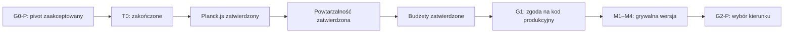

# Evolution Lab — workflow i indeks dokumentacji

**Data aktualizacji:** 2026-07-29
**Status:** G1 oraz M1–M4 ukończone; następna bramka G2-P

## 1. Historia

Discovery analityczne zakończyło się bez kodu. Historyczne propozycje i krytyka:

- [discovery/INDEPENDENT_PROPOSALS.md](discovery/INDEPENDENT_PROPOSALS.md);
- [discovery/CRITIQUE_AND_SYNTHESIS.md](discovery/CRITIQUE_AND_SYNTHESIS.md).

Pierwsza decyzja po discovery wybrała „Hodowcę jednej linii”. Storyboard G0-P wykazał jednak, że ręczna decyzja co małe pokolenie nie odpowiada intencji właściciela.

## 2. Wynik G0-P

Właściciel oczekuje doświadczenia zbliżonego do BoxCar2D:

- konfiguracja przed startem;
- automatyczne kolejne pokolenia;
- obserwacja przez dowolny czas;
- pauza, tempo, szybki tryb, replay i stop;
- brak ręcznego wyboru rodziców.

Zaakceptowano ograniczony zakres: seeded terrain, geometryczny genom o stałej topologii, dwa koła, elity, dwóch rodziców, proste krzyżowanie i mutacja.

Artefakty:

- [playtests/G0_P_PROTOCOL.md](playtests/G0_P_PROTOCOL.md);
- [playtests/G0_P_SCENARIO_01.md](playtests/G0_P_SCENARIO_01.md);
- [playtests/G0_P_RESULT_01.md](playtests/G0_P_RESULT_01.md).

Werdykt: **pivot zaakceptowany; G0-P zamknięte**.

## 3. Aktualna sekwencja

Każda strzałka oznacza osobną decyzję.

## 4. Kontrakt T0

T0 jest wyrzucalnym testem, nie początkiem produktu.

**Wynik:** zakończone; Planck.js zatwierdzony przez właściciela. Raport:
[t0/T0_BROWSER_RESULT.md](t0/T0_BROWSER_RESULT.md).

### Zakres wspólny

- deterministyczny fragment generowanego terenu;
- geometryczny pojazd z dwoma kołami;
- mała populacja;
- ranking, elita, dobór dwóch rodziców, krzyżowanie i mutacja;
- dwa automatyczne pokolenia;
- renderowanie normalne oraz szybki tryb bez renderowania;
- pauza, wznowienie i stop;
- minimalny replay rekordzisty.

### Porównanie

- wspólna, minimalna topologia browser-first;
- Rapier2D;
- Planck.js;
- Python/Pymunk wyłącznie jako osobno zatwierdzony pivot, jeśli oba adaptery przeglądarkowe nie spełnią bramek.

### Reguły

- kryteria i wagi są zamrożone przed wykonaniem;
- hashe porównuje się tylko między powtórzeniami tego samego kandydata;
- między adapterami porównuje się stabilność, wydajność, game feel, złożoność integracji i koszt;
- kod T0 pozostaje oddzielony i może zostać usunięty;
- wynik rekomenduje adapter; właściciel zatwierdził Planck.js. Platforma browser-first jest wcześniejszą decyzją właściciela.

## 5. Kontrakt implementacji

Kod produkcyjny może rozpocząć się dopiero po:

- ukończonym T0;
- decyzji o platformie i fizyce;
- zatwierdzonym kontrakcie powtarzalności;
- budżecie czasu pokolenia i responsywności;
- aktualizacji dokumentów;
- jednoznacznym GO właściciela w G1.

M1–M4 z [ROADMAP.md](ROADMAP.md) są jedynym zatwierdzanym zakresem. Rozszerzenia czekają na G2-P.

## 6. Reguły decyzji

- **Fakt** wynika ze źródła albo pomiaru.
- **Hipoteza** ma obserwowalny test.
- **Rekomendacja** ma alternatywę i kompromis.
- **Decyzja właściciela** wpływa na wartość, zakres lub koszt odwrócenia.
- **Kalibracja** rozstrzyga wartość liczbową w zatwierdzonym modelu.

Technologii nie wybiera się na podstawie preferencji. Inspiracja BoxCar2D nie oznacza kopiowania jego pełnego zakresu.

## 7. Aktualne artefakty

- [CONTEXT.md](../CONTEXT.md) — słownik domeny;
- [PROJECT_VISION.md](PROJECT_VISION.md) — wizja ciągłej symulacji;
- [PRD.md](PRD.md) — wymagania v0;
- [ROADMAP.md](ROADMAP.md) — bramki i pionowe wycinki;
- [ARCHITECTURE_OPTIONS.md](ARCHITECTURE_OPTIONS.md) — porównanie T0;
- [G1_IMPLEMENTATION_BRIEF.md](G1_IMPLEMENTATION_BRIEF.md) — porównanie stosu, moduły i zakres GO;
- [M1_M4_IMPLEMENTATION_REPORT.md](M1_M4_IMPLEMENTATION_REPORT.md) — wynik implementacji, pomiary i review;
- [GENETIC_ALGORITHM_DESIGN.md](GENETIC_ALGORITHM_DESIGN.md) — automatyczna pętla ewolucji;
- [LEARNING_EXPERIENCE.md](LEARNING_EXPERIENCE.md) — opcjonalne objaśnienia;
- [RISK_REGISTER.md](RISK_REGISTER.md) — ryzyka;
- [DECISION_BRIEF.md](DECISION_BRIEF.md) — stan decyzji;
- [WORKFLOW.md](WORKFLOW.md) — ten dokument.

## 8. Stan

- Discovery analityczne: **ukończone**.
- G0-P: **ukończone pivotem**.
- Zakres ciągłej symulacji: **zaakceptowany**.
- Zgoda na T0: **udzielona**.
- T0: **zakończone**.
- Platforma: **browser-first; Godot wykluczony**.
- Fizyka: **Planck.js 1.5.0 zatwierdzony**.
- Zakres powtarzalności: **zatwierdzony dla zachowanego buildu i runtime**.
- Budżety M1–M4: **zatwierdzone bez zmian**.
- G1: **GO udzielone**.
- M1–M4: **zaimplementowane i zweryfikowane**.
- G2-P: **następna bramka**.
